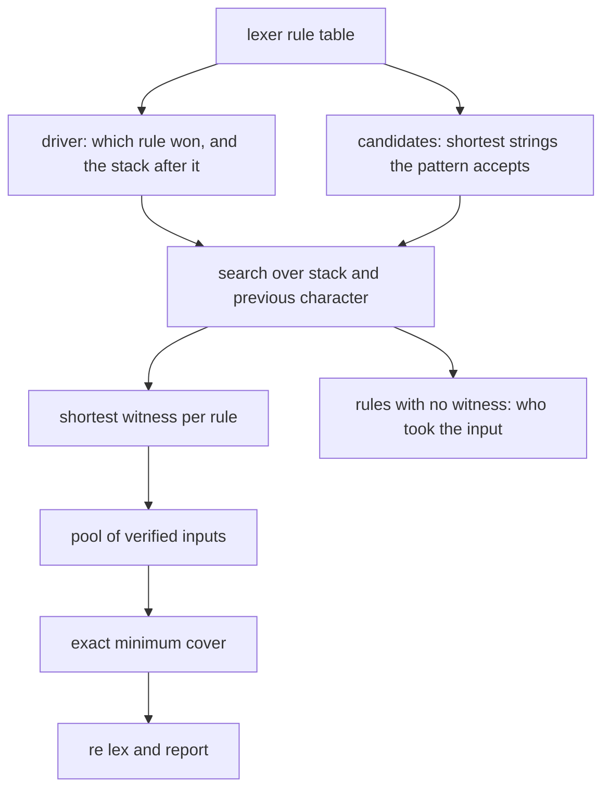
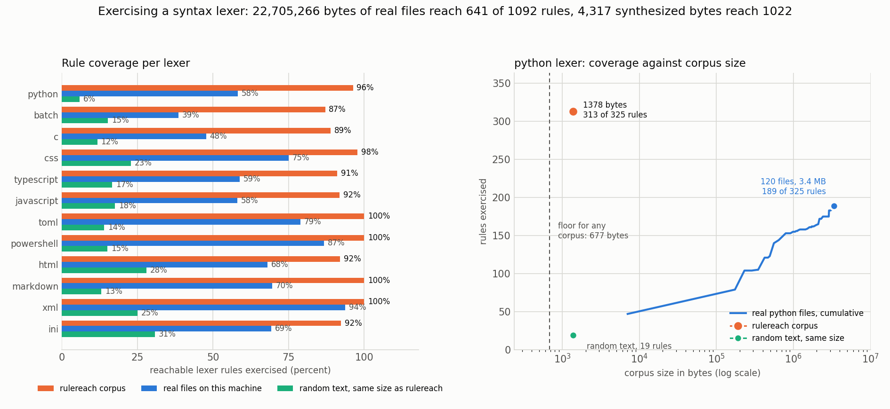

# rulereach

Synthesises the smallest input corpus that makes every rule of a syntax lexer fire, and proves which rules no input can reach.

## The problem

A large amount of real software decides things with an ordered list of regexes: try each pattern at the current position, take the first that matches, change state, repeat. Syntax highlighters, log parsers, tokenizers and config readers are all built this way. The inner loop of pygments is exactly that, and the 602 lexers it ships contain about 40,000 of these rules.

Nobody knows which of those rules actually run. Tests for a highlighter are example files, and example files are written by people, so they cover what people write. Measured on this machine, 120 real Python files from the standard library, 3.4 MB of code that has been read and edited by thousands of people, exercise **189 of the 325 reachable rules** in the pygments Python lexer. The other 136 rules have never been looked at by that corpus at all. Across twelve lexers the number is 641 of 1,092 rules from 22.7 MB of real local files.

That matters in two directions. A rule that no test reaches can be quietly wrong for years. And a rule that no *input* can reach is a bug by itself: it means an earlier pattern in the same list eats everything it was written for, and the highlighting it was supposed to produce never appears.

## What it does

rulereach takes a pygments lexer and produces three things.

1. **A witness for every rule**: the shortest text found that makes that rule win. Witnesses are produced by a best first search over the lexer's own state space, where each step appends a candidate string and asks the real lexer what happened. Candidate strings come from the pattern's parse tree, taken from `re._parser`, so they are derived from the real regex rather than guessed.
2. **A corpus**: a set of inputs covering every reachable rule, chosen to minimise total bytes (or, on request, the number of inputs). Choosing the subset is a weighted set cover over measured coverage and is solved exactly by HiGHS at a proven zero gap. Two bounds are printed next to the answer: the LP relaxation, and a floor that holds for any corpus at all.
3. **A verdict on what is left**: for every rule with no witness, which earlier rule took each of its candidate strings instead. When the pattern's language is finite and was enumerated in full, that is a proof of unreachability rather than a sample.

Every number is measured by running the lexer. The corpus is re-lexed at the end, and the reported coverage is what that run produced.

## Why it is interesting

Grammar and rule coverage is usually approached by generating inputs at random and seeing what sticks, which is why a fuzzing style corpus is large and still incomplete. The structure here allows something stronger. The lexer is a pushdown automaton whose transitions are observable, so a shortest witness per rule is a shortest path problem over an observed graph, and assembling those witnesses into a corpus is a covering problem with an exact solver and a certificate.

Two parts are worth calling out.

**The rule universe is not the rule list.** pygments materialises `include('x')` by copying x's rules into the including state while keeping `x` as its own entry. Those template entries are never pushed, so their rule tuples can never fire, and counting them would overstate the problem by 218 rules out of 1,310. rulereach takes the closure of states that something actually pushes and uses only those. The dynamic search then never fires a rule outside that closure, which is an independent check that the static reachability is right.

**The end of a string lies about the state.** Most pygments states end in `default('#pop')`, a zero width rule. When the text runs out, that rule and every pop above it fire in a cascade, so the stack after the last event describes the unwinding rather than the state the lexer was holding. Tracking the stack after the last match that consumed input instead is what takes the Python lexer from 24 of its 28 reachable states to all 28.

## Architecture

[FigJam board: rulereach architecture](https://www.figma.com/board/D7t5UAp2u4dTV0TOVZIqkT)

The diagram shows how a lexer's own rule table becomes a witness per rule, then a minimum corpus, with the real lexer acting as the oracle at every step.



## Results



The metric is how many of a lexer's reachable rules an input corpus makes fire, against the size of that corpus. The baseline is real files already on the machine the run happened on, found through each lexer's own filename globs: 1,136 files and 22,705,266 bytes of Python, C headers, CSS, JavaScript, TypeScript, HTML, XML, INI, TOML, Markdown, PowerShell and batch scripts. That corpus reaches **641 of 1,092 reachable rules**. The corpus rulereach synthesises reaches **1,022 of 1,092 in 4,317 bytes**, which is 5,260 times smaller and 381 rules further. Uniform random text of exactly the same size reaches 146.

Per lexer, from `docs/metrics.json` (Python 3.13.5, pygments 2.19.2, Windows 11):

| lexer | reachable rules | real files | real bytes | rules reached | rulereach bytes | rules reached | proved unreachable |
|---|---|---|---|---|---|---|---|
| python | 325 | 120 | 3,389,358 | 189 | 1,378 | 313 | 7 |
| batch | 171 | 6 | 8,655 | 66 | 682 | 149 | 1 |
| c | 153 | 120 | 744,331 | 73 | 718 | 136 | 5 |
| css | 92 | 120 | 3,740,941 | 69 | 417 | 90 | 1 |
| typescript | 90 | 120 | 1,707,510 | 53 | 299 | 82 | 1 |
| javascript | 74 | 65 | 4,000,206 | 43 | 214 | 68 | 1 |
| toml | 57 | 64 | 2,583 | 45 | 165 | 57 | 0 |
| powershell | 53 | 93 | 2,828,134 | 46 | 145 | 53 | 0 |
| html | 25 | 68 | 628,470 | 17 | 125 | 23 | 0 |
| markdown | 23 | 120 | 797,730 | 16 | 100 | 23 | 0 |
| xml | 16 | 120 | 1,234,483 | 15 | 58 | 16 | 0 |
| ini | 13 | 120 | 3,622,865 | 9 | 16 | 12 | 0 |

Three numbers in that table are the point of the project. **390 rules are reached only by synthesis**: no file on this machine fires them. **16 rules are proved unreachable**: every string their pattern accepts is taken by a rule above them, checked across all the contexts the search entered, with the pattern's language enumerated in full. And the corpus is **4,317 bytes against a floor of 2,385**, where the floor is the sum over rules of the characters the pattern must consume, which holds for any corpus whatsoever because matches inside one input never overlap. Asking for the fewest inputs instead of the fewest bytes gives 227 inputs and 4,894 bytes; the whole Markdown lexer fits in one 103 byte file.

Two of the unreachable rules, both verifiable by eye:

- The CSS lexer's `atrule` state has `\{` at position 0 going to state `atcontent`, and the identical pattern `\{` again at position 4 going to state `content`. The first always wins, so the second branch is dead code.
- The C lexer's `case-value` state puts the identifier pattern at position 1, before `case\b` at 15 and before every type keyword below it. Inside a `case` label, `case`, `bool` and `__m128` are therefore emitted as plain names rather than keywords.

## How to run it

```
pip install -r requirements.txt
python scripts/run_demo.py            # all twelve lexers, writes docs/metrics.json
python scripts/make_chart.py          # writes docs/before_after.png from that json
python examples/quickstart.py css     # one lexer, printed to the terminal
python -m pytest tests/ -q            # 9 tests, about 20 seconds
```

`run_demo.py` takes about two minutes. Most of that is lexing the real baseline files, not the search: the search itself finishes in under 1.5 seconds per lexer, exhausts its queue in all twelve, and enters every reachable state in ten of them. Pass lexer names to restrict it, for example `python scripts/run_demo.py python css`.

The baseline needs real files to measure against. They are found by walking a short list of local directories (the standard library, site-packages, the Windows INF and PowerShell directories, a VS Code installation) and cached in `docs/file_index.json`. On a machine with none of those the baseline is simply smaller; nothing else changes.

## Example outputs

```
$ python examples/quickstart.py css
css lexer: 109 rules declared, 92 of them in reachable states
search: 48 nodes, 3224 probes, 7 of 7 reachable states entered, 90 rules witnessed
corpus: 7 inputs, 434 bytes, floor for any corpus is 207 bytes

  119 bytes  '-!:-.-#-""\'\'@-;@-\t@-!@-{\t@-{-@-{!@-{}@-:-@-.-@-#-@-\t-@-""@-\'\'@-/**/@-{'
  119 bytes  '{-o-{-A:{A:low{A:red{A:cue{A:hsl({A:A-(.0{A:A-(""{A:A-(\'\'{A:A-(low{A:A'
  115 bytes  '\t{{\t{}{;{\n@\n{A:{A:0{A:\t{A:({A:;{A:}@-{:-@-{.-@-{#-@-{""@-{\'\'{all:{A:0q'
  55  bytes  '/**/{/**/{A:.0{A:url(){A:url(""){A:url(\'\'){A:A-(url(\'\')'
  13  bytes  '{A:!important'

re-lexed the corpus: 90 of 90 rules fired
rule ('atrule', 4) cannot fire: pattern \{ is taken by rule ['atrule', 0]
```

Those five strings are not pretty CSS, and they are not meant to be. They are the shortest text that drives the lexer through 90 distinct rules, and the last line is the one rule that no text can drive it through.

## What is checked, and what is assumed

The dispatch loop here is a transcription of pygments', and `driver.assert_equivalent` compares it token for token against the upstream loop. The demo run checks 2,933,073 bytes of real files that way, and the tests check more. Lexers that override `get_tokens_unprocessed` to relabel token types afterwards, like the C family promoting `size_t` to a type keyword, are compared against `RegexLexer.get_tokens_unprocessed`, the loop that chooses rules; the relabelling happens after a rule has already won and cannot change coverage.

Honest limits:

- Only plain `RegexLexer` lexers. `ExtendedRegexLexer` passes a context object to its callbacks, which this driver does not build, so YAML and Ruby are out of scope.
- The search treats two positions as the same node when the state stack and the preceding character agree. That bounds how much of the state space gets explored; it never affects whether a reported witness is real, because every witness is produced by lexing the text.
- A state that is only ever entered by a zero width rule is not held by that node model, because the stack is read after the last match that consumed input. The JavaScript and TypeScript lexers each have one such state, `badregex`, entered through a bare lookahead; their rules are the two states out of 100 in the panel that the search does not enter.
- Candidate strings are generated from the pattern's parse tree with caps on alternation and repetition. Lookaround and backreferences are not modelled and are flagged as approximate; a rule flagged that way with no witness proves nothing. Of the 70 rules with no witness, 16 are proved unreachable, and the rest are reported with the reason.
- The minimum corpus is minimum over the pool of inputs that were generated and verified, solved exactly with a zero gap. The floor beneath it is unconditional, and both are printed.

## Layout

```
rulereach/
  driver.py      transcribed dispatch loop, which rule won, stack tracking
  candidates.py  shortest strings a pattern accepts, from re._parser
  explore.py     best first search for a shortest witness per rule
  corpus.py      pool construction, exact cover, the floor
  shadow.py      why a rule never fires, with the rule that takes its input
  baseline.py    real local files, coverage curves, random comparison
scripts/         run_demo.py, make_chart.py
examples/        quickstart.py
tests/           brute force checks of the search and the cover
docs/            metrics.json, corpora.json, before_after.png
```
